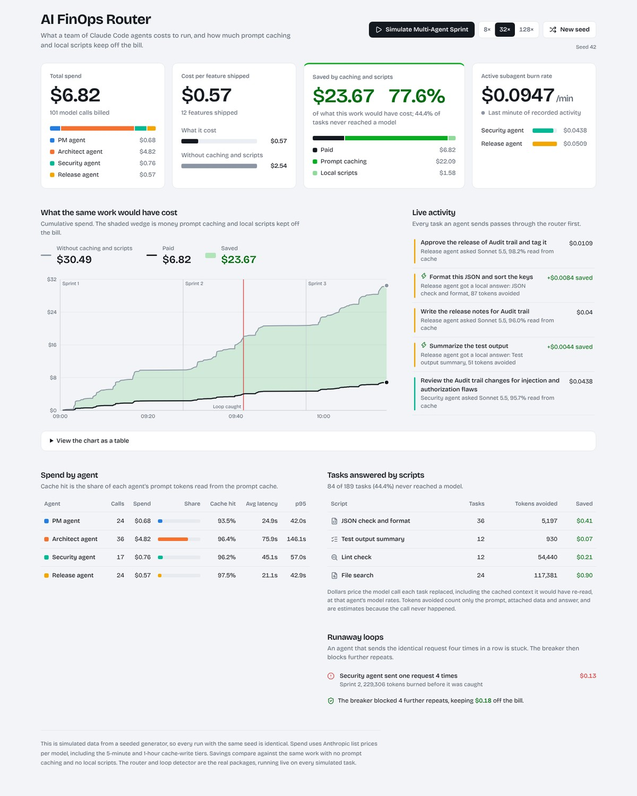
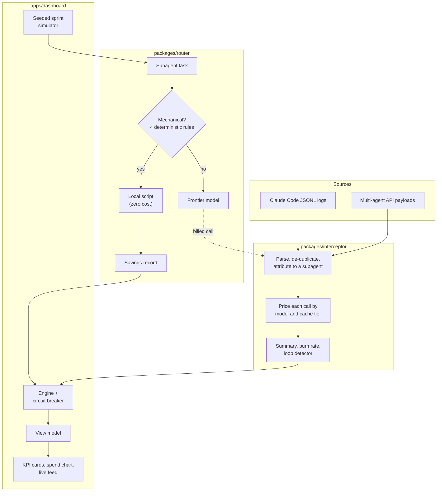
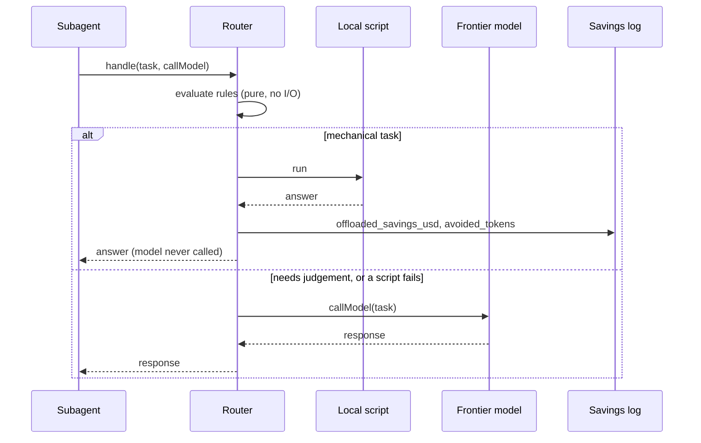

# AI FinOps Router

Unit economics for multi-agent Claude Code workflows: what a team of agents costs to run, what prompt
caching saves, and which tasks never needed a frontier model in the first place.



Three packages, each usable on its own:

| Package | Job |
|---|---|
| [`packages/interceptor`](packages/interceptor) | Reads Claude Code JSONL session logs and multi-agent API payloads. Computes exact per-call cost, cache hit rate, latency and **cost per subagent** (`PM_Agent`, `Architect_Agent`, `Security_Agent`, `Release_Agent`). Detects runaway loops. Has a CLI. |
| [`packages/router`](packages/router) | Sits in front of the model. Answers purely mechanical tasks (lint, JSON, grep, test-output summaries) with local scripts **before any LLM call**, and logs the dollars and tokens each one avoided. |
| [`apps/dashboard`](apps/dashboard) | Next.js executive UI with a live multi-agent simulator. Runs the real router and loop detector on every simulated task. |

## Quickstart

```bash
./init.sh
```

Installs dependencies, runs every test, typechecks, then serves the dashboard at <http://localhost:3000>.
Add `--no-dev` to stop before starting the server.

Or step by step:

```bash
npm install
npm test
npm run dev --workspace @ai-finops/dashboard
```

Click **Simulate Multi-Agent Sprint**. At the default 32x speed a sprint takes about 35 seconds; at 128x, about 9.
About 24 seconds in, a Security agent gets stuck repeating one request: watch the loop get caught and
the circuit breaker stop the repeats. **New seed** regenerates the whole history.

### Parse your own logs

```bash
npm run finops -- ~/.claude/projects                # every session log, recursively
npm run finops -- path/to/session.jsonl --json      # machine-readable
npm run finops -- payloads.json --format payload    # multi-agent API payloads (JSON array or NDJSON)
```

## Architecture



Dependencies point one way: `dashboard` -> `router` -> `interceptor`. The router prices the calls it avoids
with the interceptor's own cost engine, so a dollar saved and a dollar spent are computed the same way.



## Interceptor

```ts
import { parseClaudeCodeJsonl, summarize, detectRunawayLoops, formatSummaryReport } from "@ai-finops/interceptor";

const { events, warnings } = parseClaudeCodeJsonl(jsonlText);
const summary = summarize(events);

summary.totalCostUsd;                // exact, from integer token counts x per-MTok prices
summary.cacheHitRate;                // cache reads / all prompt tokens
summary.cacheSavingsUsd;             // vs. the same traffic with no caching (negative if writes were never read)
summary.byAgent;                     // cost, calls, cache hit, avg and p95 latency per subagent
summary.costPerFeatureUsd;           // spend / features that reached the feature_shipped milestone
detectRunawayLoops(events);          // agents repeating one identical call
```

What the parser gets right, each learned from a real Claude Code log rather than assumed:

- **One log line per content block.** Claude Code repeats a call's full `usage` on every line of a multi-block
  message. Summing lines overcounts about 4x (a real session: $13.61 naive, $3.21 correct). Calls are
  de-duplicated on `message.id` + `requestId`, keeping the largest `output_tokens`.
- **Two cache-write tiers.** 5-minute writes cost 1.25x input and 1-hour writes 2x. Logs carry the split in
  `cache_creation.ephemeral_*`; a flat multiplier would misprice real sessions.
- **Cache-read rates are per model** (0.025x to 0.1x of input), not a flat 10%.

## Router

| Rule | Answers | Declines |
|---|---|---|
| `json-format` | Validate, pretty-print, minify, sort keys, check against a JSON Schema | "Fix" or "explain" requests; schemas using `$ref`, `if`, `format`, ... |
| `test-summary` | Counts and a failure list from vitest, jest, pytest or `go test -v` output | Anything asking *why* a test failed; unrecognised runners |
| `lint-check` | Trailing spaces, mixed indent, long lines, missing final newline, `debugger`, conflict markers | "Fix the lint errors" |
| `grep-search` | Literal or regex search across attached files, grep-style output | Explain-and-search requests; regexes prone to catastrophic backtracking |

A rule fires only when the answer is fully mechanical. Anything that needs judgement, or that the local
script cannot evaluate completely, goes to the model. If a script throws, the router skips it and the model
handles the task, so a faulty rule can never fail an agent.

```ts
import { createRouter } from "@ai-finops/router";

const router = createRouter({ onOffload: (record) => log.write(JSON.stringify(record)) });
const result = await router.handle(task, (t) => callClaude(t));   // callClaude runs only if no script applies
```

Each offloaded call logs one record:

```json
{
  "task_id": "s3-f2-lint",
  "timestamp": "2026-11-03T10:14:05.000Z",
  "agent": "Security_Agent",
  "model": "claude-sonnet-5-5",
  "rule_id": "lint-check",
  "avoided_input_tokens": 23,
  "avoided_cache_read_tokens": 62000,
  "avoided_output_tokens": 32,
  "avoided_tokens": 62055,
  "offloaded_savings_usd": 0.006566,
  "priced": true,
  "token_counts": "estimated"
}
```

`offloaded_savings_usd` is the price of the model call that did not happen, from the interceptor's cost
engine: the prompt and attached data at the input rate, the cached context it would have re-read at the
cache-read rate, and the script's answer at the output rate. It is a modelled counterfactual and deliberately
conservative: re-read context counts only if the task states `contextTokens`, and the answer carries no model
preamble. Token counts are estimates (about 4 characters per token, replaceable via `estimateTokens`) because
no model call exists to read usage from.

## Dashboard

The four cards: **Total spend**, **Cost per feature shipped**, **Saved by caching and scripts** (dollars and
percent), and **Active subagent burn rate** (dollars per minute over the trailing minute, per agent). The hero
chart plots cumulative spend against what the same work would have cost with no caching and no scripts; the
wedge between the lines is the saving. A table view of the chart sits beneath it.

The simulator is a seeded generator: the same seed gives the same sprint on any machine. Mechanical tasks carry
realistic payloads (source files, JSON documents, vitest output) and are answered by the real router scripts;
model calls draw usage from distributions shaped like real Claude Code sessions (about 96% of the prompt read
from cache). When an agent sends the identical request four times in a row, the loop detector fires and a
circuit breaker blocks its further repeats.

Across 25 seeds the opening history shows caching and routing together cutting the bill by 76.9% to 78.3%,
and the test suite requires at least 65% for every one of them. Read that number for what it is: the savings
come from the scenario's assumptions, not from measurement. Prompt caching delivers about 93% of the dollars
saved, and it does so because the simulated agents read about 96% of their prompt from cache (the figure
a real Claude Code session showed). Scripts account for roughly 7% of the dollars saved. The "44% of tasks never
reached a model" figure is fixed by the scenario's task mix (7 of every 15 tasks are mechanical by design), so
it is not a prediction for your fleet. Point the CLI at your own logs for real numbers.

## Limits worth knowing

- **Subagent attribution from real logs is unverified.** Attribution uses explicit agent tags or the Task call
  that spawned a sidechain. The only real log available had no sidechain lines, so that path is covered by
  fixtures built from the documented fields, not by real subagent logs.
- **Pricing.** Eight models are fully documented. `claude-opus-4-6/4-7/4-8`, `claude-sonnet-4-6` and
  `claude-haiku-4-5` use an assumed 0.1x cache-read rate and are flagged `assumed` in every report. Models not in
  the table (for example `claude-haiku-5-5`, which has a >100K-token price tier) are reported as unpriced, never
  guessed. Fast-mode price multipliers are not modelled. Pass your own `PricingTable` to override anything.
- **Dashboard data is simulated.** The figures in the screenshot come from the seeded generator, not from a real fleet.
- `lint-check` is a built-in hygiene linter over in-memory files, not a wrapper around your ESLint config.

## Development

Every behaviour was written test-first and the critical ones were mutation-checked: break the logic, confirm a
test fails.

| Command | What it does |
|---|---|
| `npm test` | All unit tests across the workspaces |
| `npm run typecheck` | Strict TypeScript (`noUncheckedIndexedAccess`, `exactOptionalPropertyTypes`, no `any`) |
| `npm run build` | ESLint, then the Next.js production build |
| `npm run record-tests` | Runs the suites and writes `tests.json` (generated, never hand-edited) |

Project conventions and architecture boundaries are in [`CLAUDE.md`](CLAUDE.md); build state is in
[`progress.txt`](progress.txt).
